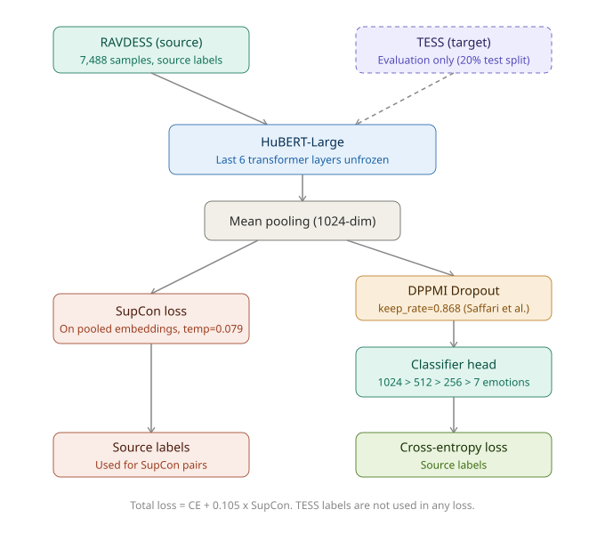

# Cross-Corpus Speech Emotion Recognition
## HuBERT + DPPMI Sparse Dropout + Supervised Contrastive Learning

[](https://python.org)
[](https://pytorch.org)
[](LICENSE)

---

## Overview

This project addresses **cross-corpus Speech Emotion Recognition (SER)** — training on one dataset (RAVDESS) and evaluating on a completely different one (TESS) across 7 shared emotion classes.

> **Setup (as implemented in `notebooks/SER_Final.ipynb`):** The classifier is trained on RAVDESS labels (cross-entropy + supervised contrastive loss on RAVDESS embeddings). TESS audio is passed through the model during training, but TESS labels do not enter any loss. TESS is split 80/20 (stratified, seed 42); the 20% split (1,120 clips) is the test set reported below.

---

## Novel Contributions

1. **DPPMI Dropout for Speech** — Applies Saffari et al.'s DPPMI dropout to SER. It keeps the most informative and diverse neurons (DPP + mutual-information scoring), giving sparse representations.

2. **Supervised Contrastive Learning for cross-corpus SER** — A SupCon loss on RAVDESS embeddings is added to cross-entropy.

3. **3-way ablation** — HuBERT only, HuBERT + DPPMI, and HuBERT + DPPMI + SupCon, trained with the same tuned hyperparameters.

---

## Architecture



---

## Results

### Ablation Study (RAVDESS to TESS, 7 emotions)

| Model | Best-epoch target accuracy | Final-epoch accuracy |
|-------|---------------------------|----------------------|
| HuBERT Only | 59.91% | 55.18% |
| HuBERT + DPPMI | 61.34% | 60.98% |
| HuBERT + DPPMI + SupCon | **64.29%** | 63.66% |

Numbers are read from `results/json/hist_*.json` (single run, seed 42).

**How to read these results**
- The same 20% TESS split is used for evaluation *and* for checkpoint selection, early stopping, the LR scheduler, and the Optuna search. The best-epoch numbers are therefore optimistic, and the final-epoch column is the more conservative figure.
- With 1,120 test clips, one percentage point is about 11 clips. With a single seed, the gaps between rows (1.4 and 3.0 points) are suggestive, not conclusive.
- An earlier version of this README reported 99.73% for the full model. That figure came from an evaluation in which test data had been exposed during training, and it has been removed.
- `result_hubert_only.json` stores 56.61%, while the training history peaks at 59.91%; the table uses the history peak.

Per-class results for the final run are not included yet.

---

## Datasets

| | RAVDESS (Source) | TESS (Target) |
|---|---|---|
| Files | 1,248 (aug. to 7,488) | 5,600 |
| Speakers | 24 actors | 2 speakers |
| Labels used | CE + SupCon | None in training (evaluation only) |
| Test split | None | 20% held out (1,120 clips) |

**7 shared emotions:** angry, disgust, fear, happy, neutral, sad, surprise

---

## Hyperparameters (Optuna-tuned)

| Parameter | Value |
|-----------|-------|
| lr_hubert | 3.69e-05 |
| lr_head | 1.43e-04 |
| lambda_supcon | 0.105 |
| supcon_temp | 0.079 |
| keep_rate (DPPMI) | 0.868 |
| unfreeze_n | 6 |

---

## Setup

```bash
pip install torch transformers librosa scikit-learn optuna matplotlib seaborn pandas numpy joblib
```

Download datasets:
- [RAVDESS](https://zenodo.org/record/1188976) — Audio_Speech_Actors_01-24.zip only
- [TESS](https://www.kaggle.com/datasets/ejlok1/toronto-emotional-speech-set-tess)

Open notebooks/SER_Final.ipynb in Google Colab with A100 GPU.

---

## Project Structure

- `notebooks/SER_Final.ipynb` — 3-way ablation study (main)
- `notebooks/SER_V1.ipynb` — WavLM + DPPMI + SimCLR experiment
- `results/json/` — Training histories and accuracy metrics
- `results/figures/` — Figures. **Note:** `confusion_matrix.png`, `per_class_f1.png`, `training_curves.png` and `architecture.svg` come from an earlier run and do not match the results above; regenerate them from the final notebook before citing them.

---

## Training Details

- **Hardware**: NVIDIA A100-SXM4-40GB
- **Optimizer**: AdamW with differential LR
- **Scheduler**: ReduceLROnPlateau (driven by target test accuracy)
- **Audio**: 4.5s, 16kHz, silence-trimmed, loudness-normalized
- **Augmentation**: Gaussian noise, pitch shift, time stretch
- **Epochs**: 50 max, early stopping patience=10 (on target test accuracy)
- **Seed**: 42, single run per model

---

## Acknowledgements

- DPPMI: Saffari et al., Purdue University Northwest
- SupCon: Khosla et al., NeurIPS 2020
- HuBERT: Hsu et al., Facebook AI Research, 2021
- RAVDESS: Livingstone & Russo, PLOS ONE 2018
- TESS: University of Toronto

---

## Author

**Shahwar** — MS ECE
GitHub: [Shahwar98](https://github.com/Shahwar98)
